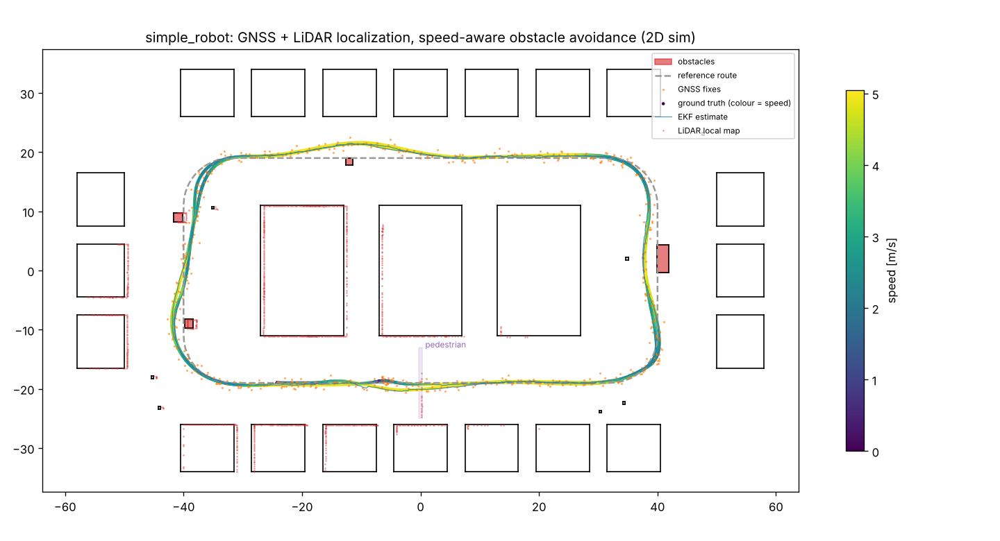

# simple-robot

A simple wheeled robot with **Ackermann steering** that localizes with **GNSS + LiDAR**,
avoids static and moving obstacles with **speed- and inertia-aware** safety margins, and
drives a route in the **[CARLA](https://carla.org) simulator**.



*Standalone 2D simulation (`scripts/run_sim2d.py --plot sim2d.png`), two laps of an
obstacle course: a parked car half-blocking the lane, a crate, a slalom and a pedestrian
pacing across the road. The colour of the true trajectory is the speed: the robot slows
for tight passes and for the pedestrian, and keeps more clearance the faster it goes.*

## Architecture

```
            CARLA (or the built-in 2D sim)
   ┌──────────────┬──────────────┬───────────────────┐
   │ GNSS lat/lon │ 3D LiDAR     │ wheel speed+steer │
   ▼              ▼              ▼                   │
 gnss.py       lidar.py         (odometry)           │
 lat/lon→ENU   height slice→2D                       │
   │           ICP vs local map                      │
   │           → relative motion                     │
   ▼              ▼              ▼                   │
 ┌──────────── localization.py / ekf.py ──────────┐  │
 │ EKF on (x, y, yaw), bicycle-model prediction   │  │
 │ GNSS: absolute update (with antenna lever arm) │  │
 │ LiDAR: relative update via stochastic cloning  │  │
 │ auto-init: heading from GNSS track vs odometry │  │
 └───────────────────────┬────────────────────────┘  │
                         ▼   map pose               │
   planning.py (route, speed profile)                │
                         ▼                           │
 ┌──────────── avoidance.py (local planner) ──────┐  │
 │ LiDAR obstacles + tracked movers (odom frame)  │  │
 │ candidate swerves → closed-loop rollouts       │  │
 │ → footprint collision check → safe speed       │  │
 │   (stopping distance, reaction time, lag)      │  │
 │ stop-or-go, emergency rules, back-up recovery  │  │
 └───────────────────────┬────────────────────────┘  │
   control.py (pure pursuit + PID + brake limit) ── robot.py
                         │ steer angle, speed, gear
                         ▼
          carla_bridge.py → VehicleAckermannControl
```

| Module | What it does |
| --- | --- |
| `vehicle.py` | Ackermann geometry (inner/outer wheel angles), kinematic bicycle model about the rear axle |
| `gnss.py` | Exact inverse of CARLA's GNSS geo-projection, plus a WGS-84 ECEF→ENU converter for real hardware |
| `lidar.py` | 3D cloud → 2D scan, voxel filter, robust point-to-line ICP with Hessian covariance, sliding local map |
| `ekf.py` | SE(2) EKF with GNSS, absolute-pose and relative-pose (stochastic cloning) updates, χ² gating |
| `localization.py` | Initialization and sensor fusion logic |
| `planning.py`, `control.py` | Path with curvature-limited speed profile, pure-pursuit steering, PID speed |
| `avoidance.py` | Local planner: speed/inertia-aware obstacle avoidance, moving-obstacle tracking and prediction, recovery |
| `robot.py` | The autonomy loop, independent of the simulator |
| `carla_bridge.py` | Spawns the vehicle and sensors in CARLA, runs synchronous mode, converts frames, applies control |
| `sim2d.py` | Lightweight 2D simulator (ray-cast LiDAR, noisy GNSS/odometry, drivetrain lag, obstacles, a pedestrian) for testing without CARLA |

### Localization design notes

* **GNSS** gives absolute position but no heading. At start-up the robot rolls forward
  slowly. A 2D rigid alignment between the dead-reckoned odometry track and the GNSS
  track then gives the initial position *and* heading.
* **LiDAR** is used as scan-to-local-map odometry. The local map is kept in its own
  "lidar-odom" frame and is never corrected by GNSS. The motion between consecutive
  scans is fused as a *relative* measurement through stochastic cloning, which keeps
  the LiDAR and GNSS information statistically independent. Inserting scans at the
  fused pose instead would make the LiDAR measurement echo the filter's own past
  estimate and override GNSS.
* ICP covariance comes from the point-to-line Hessian. In geometrically degenerate
  places, such as a featureless corridor, it automatically becomes uncertain along
  the corridor.
* Coordinate frames: CARLA is left-handed (y right, yaw clockwise in degrees). The
  stack is right-handed ENU (x east, y north, yaw counter-clockwise in radians).
  `carla_bridge.py` holds every conversion: `(x, y) → (x, −y)`, `yaw → −yaw`.

## Obstacle avoidance: speed- and inertia-aware

Every LiDAR scan (10 Hz) the local planner in `avoidance.py`:

1. **Builds candidate swerves.** The route is shifted sideways by −3…+3 m. The
   transition length grows with speed, so a swerve never needs more than `a_lat_max`
   lateral acceleration: `L ≥ v·√(6·|Δd| / a_lat_max)`. A committed swerve is
   anchored to the route, so re-planning continues it instead of restarting it.
2. **Rolls each candidate out in closed loop.** The pure-pursuit controller, the
   steering-rate limit and the bicycle model are simulated together, so the checked
   trajectory is what the car can actually drive.
3. **Checks the swept footprint** (a chain of circles covering the vehicle outline)
   against the LiDAR points. The safety margin grows with speed:
   `margin = 0.4 m + 0.08 s · v`.
4. **Gives each candidate the highest speed it can still stop from** before the first
   conflict. This is the inertia part:
   `v·t_react + v² / (2·a_brake) ≤ s_free − buffer`. The reaction time includes the
   drivetrain/brake lag (`accel_tau`), and the speed is also capped by
   `√(a_lat_max / κ)` on the rollout's curvature.
   Candidates are checked at the speed reachable before the next plan, and the robot
   is never commanded faster than that, so every speed it drives has been validated.
5. **Picks the cheapest candidate.** The cost adds up offset from the route, switching,
   unused clearance, lost speed and obstruction within the horizon. The obstruction
   term makes it swerve while there is still room, instead of braking in front of an
   obstacle until it is too close to steer around it.

Between plans the speed controller keeps braking at least as hard as needed to stop
within the remaining free distance.

**Moving obstacles.** LiDAR points are clustered, and small clusters are tracked to
estimate their velocity. A track only counts as *moving* with point-level evidence:
most of its points must be where nothing was half a second ago. Viewpoint changes make
static objects seem to move, so this check matters. Everything seen is still an
obstacle where it is *now*; motion only adds predicted future positions, with an
uncertainty that grows with time. The robot passes a walker only if the timing clearly
works out; otherwise it stops short of the walker's predicted *path*, not just its
predicted position. Late detections are handled as a stop-or-go dilemma. If the robot
can no longer stop short but holding its speed clears the path in time, it goes
through, and that decision has hysteresis. If it finds itself standing in a walker's
way, it backs out.

**Emergency rules.** A candidate is only eligible if the robot can stop on it before
its first conflict at full braking. If none is eligible, the robot brakes along the
candidate with the most room before *static* (certain) obstacles, and ties go to the
committed swerve. It never swerves back into what it was avoiding.

**Getting unstuck.** An Ackermann car can't turn on the spot. If the robot makes no
progress for 4 s, it backs up. It tries reversing left, straight and right, plans
forward from where each would end, and picks the best (an N-point-turn look-ahead).
The swerve that led into the dead end is penalised for about 10 s.

**Frames.** Obstacle tracking, local planning and path tracking run in a smooth
wheel-odometry frame. The GNSS-corrected map pose only places the route. Otherwise
every GNSS correction (0.1–0.2 m) would jolt the robot sideways next to obstacles and
make static objects look as if they were moving.

All parameters are in `AvoidanceConfig` and `TrackerConfig`. The vehicle's own limits
(`max_decel`, `max_accel`, `accel_tau`, `max_steer_rate`, footprint) come from
`AckermannParams`, and in CARLA they're read from the vehicle's physics model and
bounding box.

## Quick start (no CARLA needed)

```bash
pip install -r requirements.txt
python scripts/run_sim2d.py --plot sim.png                    # obstacle course: avoidance + localization
python scripts/run_sim2d.py --no-avoidance                    # compare: follow the route blindly (crashes)
python scripts/run_sim2d.py --no-obstacles --plot clear.png   # empty road
python scripts/run_sim2d.py --no-obstacles --gnss-outage 40 70  # LiDAR bridges a GNSS outage
python -m pytest
```

**Obstacle course** (120 s, 40 random seeds, 6 m/s top speed, 0.3 s drivetrain lag, a
parked car, a crate, a two-gate slalom and a pedestrian pacing across the road every 10 s):

| | With avoidance | Following the route blindly |
| --- | --- | --- |
| Collisions | **0** in 40 runs | 10 per run |
| Laps completed | 1.94 on average (at least 1.5) | 2.47 |
| Minimum clearance | 0.69 m on average; worst 0.00 m (one run, pedestrian, robot backing out of its way) | — |
| Time blocked / reversing | 3.7 s / 2.2 s on average | — |

On the empty road the same stack completes 2.24 laps.

**Localization** (120 s, empty road, 0.5 m GNSS noise, 3 % wheel-speed scale error):

| Configuration | Position RMSE | Max error | Yaw RMSE |
| --- | --- | --- | --- |
| GNSS + LiDAR | 0.20 m | 0.62 m | 1.0° |
| GNSS only | 0.33 m | 0.78 m | 1.6° |
| GNSS + LiDAR, 30 s GNSS outage | 0.79 m | 3.2 m | 1.4° |
| GNSS only, 30 s GNSS outage | 1.61 m | 6.3 m | 2.7° |

## Running in CARLA

1. Install CARLA **0.9.14 or newer** (needed for `VehicleAckermannControl`; use
   `--control pid` on older 0.9.x versions) and start the server:
   ```bash
   ./CarlaUE4.sh -quality-level=Low        # Windows: CarlaUE4.exe
   ```
2. Install the Python client matching the server version:
   ```bash
   pip install carla==0.9.15   # or the .whl from $CARLA_ROOT/PythonAPI/carla/dist
   ```
3. Run the robot:
   ```bash
   python scripts/run_carla.py --town Town03 --route-length 300 --plot carla.png
   # with obstacles on the route:
   python scripts/run_carla.py --town Town03 --parked-cars 4 --walkers 2
   ```

The robot spawns at spawn point `--spawn`, initializes its heading from GNSS, and then
follows a random route through the lane graph. In the CARLA window, blue dots are the
route, red dots the estimated pose and green dots the local plan. Swerves are restricted
to driving lanes through the CARLA map. A collision sensor counts contacts for
evaluation. When the run ends, `carla_run.csv` holds ground truth vs estimate, and the
position and yaw RMSE and the collision count are printed.

Useful options:

| Option | Default | Notes |
| --- | --- | --- |
| `--blueprint` | `vehicle.tesla.model3` | Any 4-wheeled vehicle; for a small robot-like car try `vehicle.micro.microlino` (CARLA ≥ 0.9.14). Wheelbase, track and max steer are read from the physics model |
| `--control` | `ackermann` | `pid` = throttle/brake/steer for older CARLA |
| `--gnss-std` | `0.5` | GNSS noise added by CARLA's sensor [m] |
| `--no-lidar` | off | GNSS + wheel odometry for localization (LiDAR is still used for avoidance) |
| `--v-max` | `6.0` | Max speed [m/s] |
| `--parked-cars N` | `0` | Park N static cars along the route, alternating sides, partly blocking the lane |
| `--walkers N` | `0` | N pedestrians pacing back and forth across the route |
| `--no-avoidance` | off | Follow the route blindly (for comparison) |

Sensor setup (`CarlaConfig` in `carla_bridge.py`): GNSS at 5 Hz on the roof; a 32-channel
LiDAR at 2.2 m running one revolution per 20 Hz simulation tick, processed at 10 Hz. A
0.5–2.5 m height band of each cloud is flattened into a 2D scan for localization, and
a 0.3–2.0 m band for obstacles. Returns from the robot's own body are removed. Wheel speed
and steering angle come from the vehicle state with added noise, emulating encoders.
Ground truth is used only for evaluation. The planner's braking deceleration (5 m/s²) and
drivetrain lag (0.3 s) are set in `CarlaConfig`. Measure them for your vehicle blueprint
and adjust; the stopping distances depend on them.

### Testing the CARLA bridge without a server

`tests/fake_carla.py` is a small stand-in for the CARLA Python API that reproduces its
conventions: left-handed frame, steer positive to the right, wheel positions in cm, and
LibCarla's geo-projection. It also has parked cars, walkers, a lane lookup and a collision
sensor. The test suite drives `scripts/run_carla.py` end-to-end against it, with and
without obstacles, which catches sign and frame errors in the bridge. It has not been run
against a real CARLA server here, so expect some tuning per map and vehicle: scan height
bands, ICP thresholds, braking deceleration and lag.

## Limitations and next steps

* The LiDAR map is local (a sliding ~40 m window), so with GNSS denied long enough the
  estimate drifts. For GNSS-free operation, add loop closure or localize against a prior
  map; `EKF.update_pose` is already there for absolute map-based fixes.
* Planar (2D) model: no pitch or roll, and slopes and ramps aren't handled. Obstacles
  are a 2D slice of the cloud, so overhangs and kerbs below the band are not seen.
* Avoidance is local: lateral offsets from the route within a ~15 m horizon, plus
  back-up recovery. It doesn't plan around large blockages, such as taking another
  street. A global re-planner on the lane graph would.
* Moving obstacles are predicted at constant velocity, with simple nearest-neighbour
  tracking. There are no traffic rules and no interaction model: the robot gives way,
  it doesn't negotiate.
* The vehicle model is kinematic. Inertia enters through braking and acceleration
  limits, drivetrain lag, the steering-rate limit and a lateral-acceleration cap, not
  through tyre slip.
